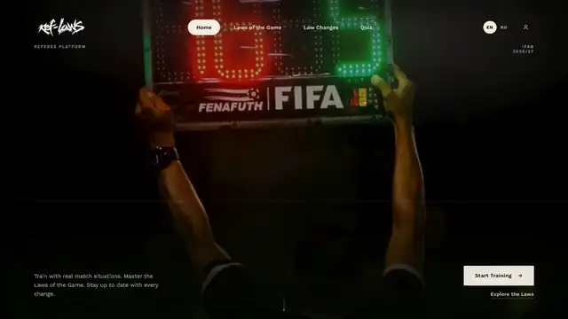
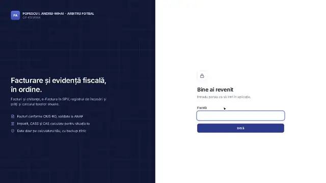
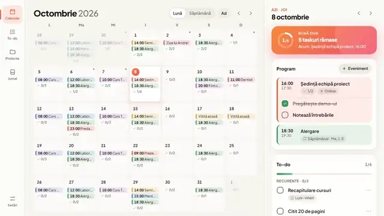
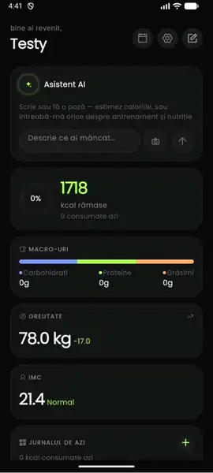
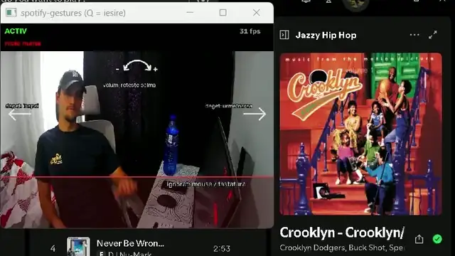

<!-- ═══════════════════════════════  HEADER  ═══════════════════════════════ -->


<p align="center">
  
  
  
  
</p>

<!-- ═══════════════════════════════  NEOFETCH  ═══════════════════════════════ -->
<p align="center">
  
</p>

<p align="center">
  <a href="mailto:radasanuflo@gmail.com"></a>
  <a href="https://www.instagram.com/radasanu.f/"></a>
  <a href="https://github.com/radasanuflorin"></a>
</p>


## `> whoami`

```ts
const florin = {
  role:        "Full-Stack Developer",
  education:   ["USV Suceava · Computer Engineering · Year II", "UTCN Cluj · Computer Engineering · Year I"],
  building:    ["web platforms", "cross-platform mobile apps", "offline-first PWAs"],
  passion:     "cyber security: breaking things to understand how to protect them",
  studying:    ["Analog electronics", "Computer organization", "Systems theory", "OOP", "Networks"],
  lookingFor:  "hands-on research in electronics & hardware systems",
  principles:  ["correctness > speed", "document every decision", "automate the boring stuff"],
  funFact:     "if I don't know something, I learn it until I do",
};
```


## `> ls ~/arsenal`

<table>
<tr><td><b>⌨️ Languages</b></td><td>


</td></tr>
<tr><td><b>🌐 Web</b></td><td>


</td></tr>
<tr><td><b>📱 Mobile</b></td><td>


</td></tr>
<tr><td><b>⚙️ Backend & Data</b></td><td>


</td></tr>
<tr><td><b>🛠️ Tools & DevOps</b></td><td>


</td></tr>
<tr><td><b>🔒 Security</b><br/><sub>my passion</sub></td><td>


</td></tr>
<tr><td><b>🔌 Hardware</b></td><td>


</td></tr>
</table>


## `> ls ~/projects`

<table>
<tr>
<td width="50%" valign="top">

### ⚽ REF-LAWS
<a href="https://github.com/radasanuflorin/ref-laws"></a> <a href="https://github.com/radasanuflorin/ref-laws"></a>


Training platform for football referees: the Laws of the Game, every law change and real-match quizzes. Bilingual EN/RO and installable as a PWA.

   
</td>
<td width="50%" valign="top">

### 🧾 Contabilitate PFA
<a href="https://github.com/radasanuflorin/contabilitate-pfa"></a> <a href="https://github.com/radasanuflorin/contabilitate-pfa"></a>


Invoicing & tax app for Romanian self-employed, used daily instead of a commercial app. Invoices and receipts, **ANAF e-Factura** with XML validated before upload, **student tax rules**, a printable cash ledger, period filters and Ctrl+K search. Runs locally over HTTPS, **51 end-to-end tests**.

     
</td>
</tr>
<tr>
<td width="50%" valign="top">

### 🗓️ RITM
<a href="https://github.com/radasanuflorin/ritm"></a> <a href="https://github.com/radasanuflorin/ritm"></a>


Offline-first personal planner: calendar, to-dos, projects and a journal, synced through Cloudflare's edge.

    
</td>
<td width="50%" valign="top" align="center">

### 🔥 Calorie Tracker
<a href="https://github.com/radasanuflorin/calorie-tracker-ai"></a> <a href="https://github.com/radasanuflorin/calorie-tracker-ai"></a>


<div align="left">

Mobile calorie tracker with an **AI assistant**: describe or photograph a meal and get an estimate. Includes home-screen widgets and i18n.

   
</div>
</td>
</tr>
<tr>
<td width="50%" valign="top">

### ✋ Gestures Spotify
<a href="https://github.com/radasanuflorin/gestures-spotify"></a> <a href="https://github.com/radasanuflorin/gestures-spotify"></a>


</td>
<td width="50%" valign="top">

<br/>

Control Spotify with **hand gestures** from a webcam, in real time and fully local.

- ✊ pause · ✋ play · 👉 / 👈 next / previous
- ✋↻ turn the hand like a **knob** for the volume
- Pointing and rotation computed from MediaPipe's **21 hand landmarks**
- Ignores the mouse area and works even at **10 fps** in dim light
- **102 tests** on simulated hands

   
</td>
</tr>
<tr>
<td colspan="2" valign="top">

### 🥤 Automatic Drink Dispenser · VHDL on FPGA
<a href="https://github.com/radasanuflorin/dozator-sucuri-vhdl"></a> <a href="https://github.com/radasanuflorin/dozator-sucuri-vhdl"></a>


First-year project at **UTCN Cluj-Napoca**: a drink dispenser written in VHDL and running on a **Digilent Nexys A7-100T** board, split into a control unit (FSM) and an execution unit.

- **5 liquid tanks** (up to 500 ml each), plus **ice** and **sugar** (up to 15 cubes each)
- **4 modes** on the switches: **refill** the tanks, **configure** up to 4 drink recipes, **view levels**, **dispense**
- Before dispensing it checks that the recipe is valid and the tanks hold enough, otherwise it shows **ERROR**
- Dispenses one stage at a time in real time (10 ml = 0.5 s, 1 cube = 1 s), with a live **countdown** on the 8-digit 7-segment display, status LEDs and debounced buttons
- Comes with a testbench covering refill, config, dispense and cancel

    
</td>
</tr>
</table>


## `> cat /proc/stats`

<p align="center">
  
</p>

## `> ./snake --eat-contributions`

<p align="center">
  <picture>
    <source media="(prefers-color-scheme: dark)" srcset="https://raw.githubusercontent.com/radasanuflorin/radasanuflorin/output/snake-dark.svg"/>
    <source media="(prefers-color-scheme: light)" srcset="https://raw.githubusercontent.com/radasanuflorin/radasanuflorin/output/snake-light.svg"/>
    
  </picture>
</p>

<!-- ═══════════════════════════════  FOOTER  ═══════════════════════════════ -->
<p align="center">
  
</p>
